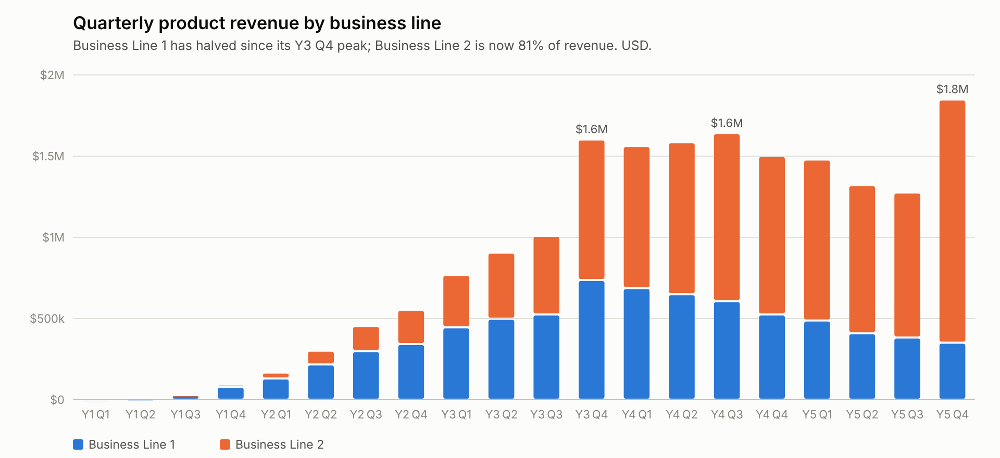
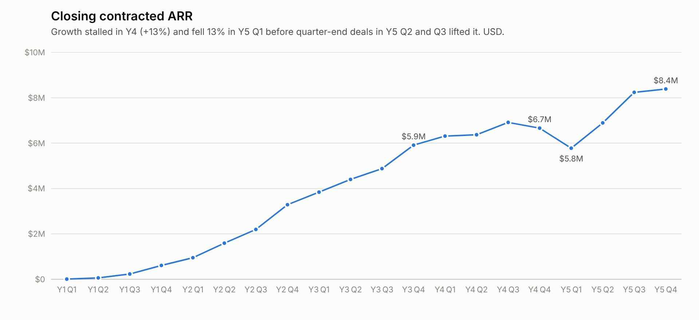
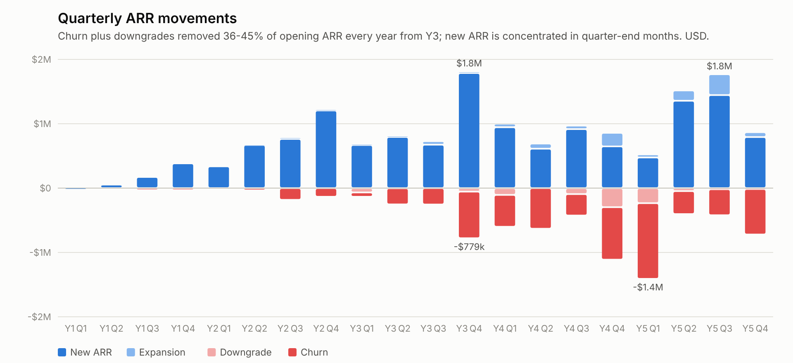
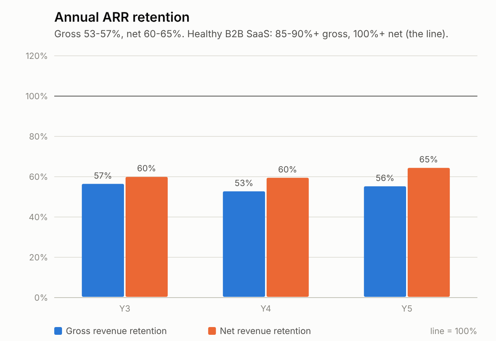
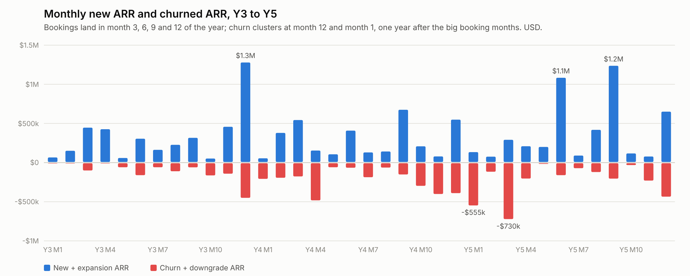
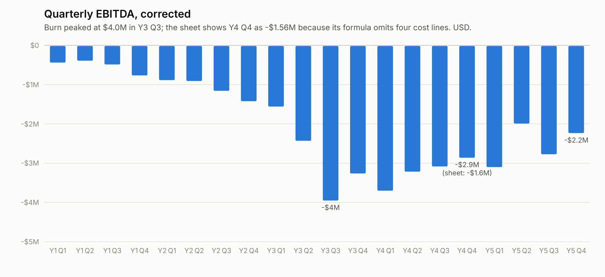
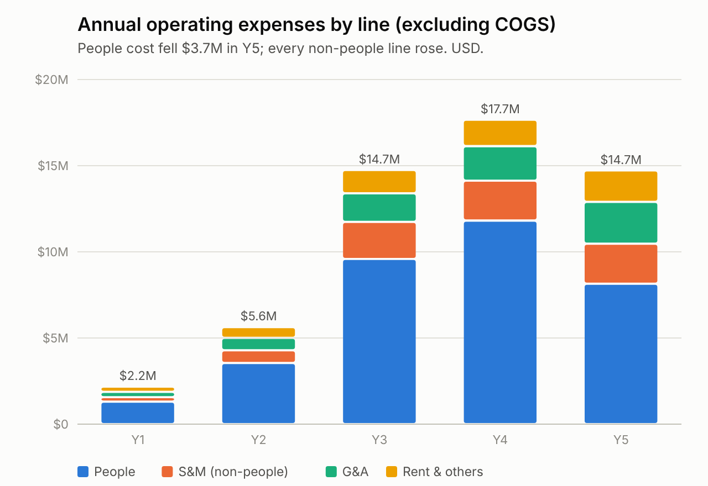
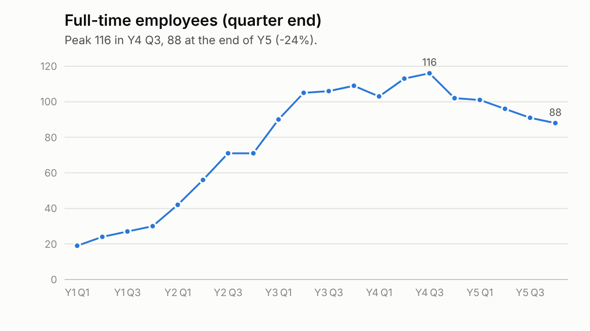
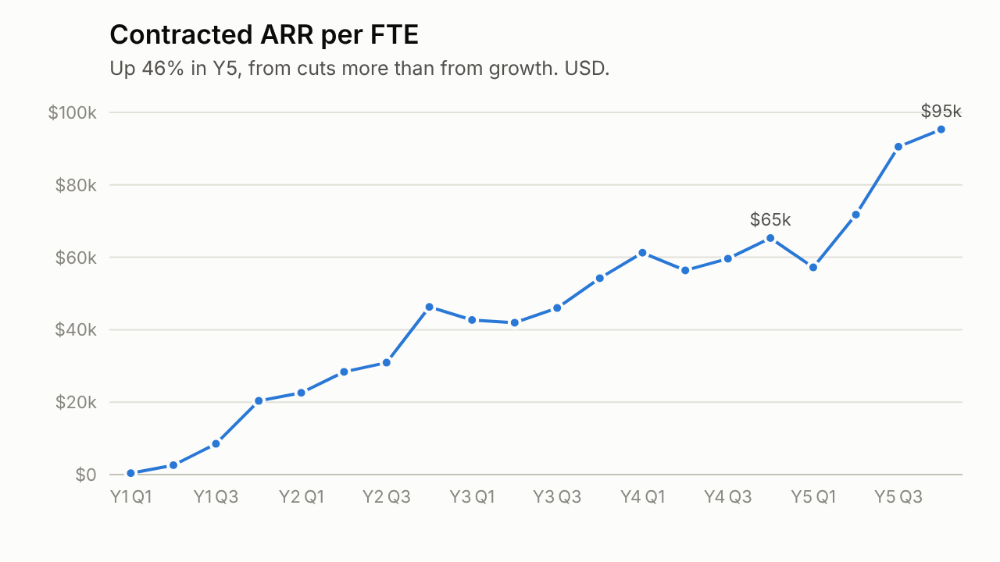

# MIS and Balance Sheet review: early-stage B2B SaaS company

**Prepared for:** Investment Partner, ahead of the next board meeting
**Source:** `MIS_FellowshipVCaseStudy_.xlsx` (Summary MIS, KPIs, P&L and Balance Sheet as per audited financial statements). All figures USD. Years and quarters are the workbook's Y1 to Y5.
**Method:** every metric below was rebuilt from the workbook's hard-coded input rows by `analysis.py`; the sheet's own formula cells were not relied on because several are wrong (Section 6). Full tables are in `derived_metrics.md`.

---

## 1. Verdict in one paragraph

This is an ~$8.4M contracted-ARR, 135-customer SaaS business that has spent Y4 and Y5 running hard to stand still. Headline ARR grew 26% in Y5 and the team was cut 24%, which is what the founders will present. Underneath, the business retains only 53-57% of its ARR each year (net 60-65%), recognised revenue fell 2-6% in Y5, EBITDA burn is still ~$10M a year against $11.7M of cash, and the Y5 cash burn was flattered by $3.1M of customer prepayments that will reverse if churn continues. The next financing is 12-18 months away and will be priced on retention, not on the ARR headline. Retention is the only problem that matters at this board.

## 2. Key takeaways

1. **The bucket leaks faster than it fills.** Churn plus downgrades removed $2.4M (Y3), $2.8M (Y4) and $3.0M (Y5) of ARR, i.e. 43-47% of opening ARR every year. Gross revenue retention is 53-57%; net revenue retention is 60-65%. At the current rate the company must sign ~$3.7M of new ARR each year just to stay flat, roughly 90% of what it signed in its best year.
2. **Y4 was a lost year and Y5 is a partial recovery, not a re-acceleration.** ARR grew 13% in Y4 at a burn multiple of 17x (burned $12.9M to add $0.75M of net ARR). Y5 net new ARR was $1.7M on $10.2M of burn (5.9x). "Good" is below 2x.
3. **Growth is bought at quarter-ends and lost at anniversaries.** 72% of Y5 new ARR landed in months 3, 6, 9 and 12. Two single months (Y5 M6 and M9) contributed $2.1M of the $4.1M annual total. Churn clusters in month 12 and month 1, one year after the big booking months, which points to annual contracts not renewing. The Y5 M6 and M9 cohorts come up for renewal in Y6 M6 and M9: that is the single biggest ARR risk in the next 12 months.
4. **Revenue and ARR have decoupled.** Contracted ARR is up 26% but FS revenue is down 2.5% (MIS: down 6%). Business Line 1 revenue has fallen 52% from its Y3 Q4 peak; Business Line 2 is now 81% of revenue but grew only 12% in Y5. The quarterly revenue-to-MRR ratio swings between 73% and 136%, so quarterly revenue is not a reliable run-rate indicator.
5. **Unit economics do not yet work.** Fully-loaded CAC is ~$97k against a new-logo ACV of ~$67k, giving a gross-margin-adjusted payback of 23 months, longer than the 27-33 month customer lifetime that churn implies. LTV/CAC is 1.2-1.6x depending on the lifetime assumption. The sheet's 36-month lifetime is an unused hard-code.
6. **The cost base was cut in people only.** People cost fell $3.7M (31%) in Y5 while every non-people line rose: G&A +21%, rent +19% (with 24% fewer heads), "Others" +19%. Non-people opex was $6.6M in Y5 versus $5.9M in Y4. G&A alone is 41% of revenue.
7. **Runway is 14-19 months and depends on prepayments.** Cash fell $7.4M in Y5 to $11.7M, but $3.1M of that cushion came from deferred revenue doubling to $6.2M (74% of ARR, up from 47%). On EBITDA burn the runway is 14 months; on Y5 Q4 run-rate 16 months. No equity came in during Y5. A fundraise needs to start within two quarters.
8. **The MIS itself cannot be trusted without rework.** Y4 Q4 EBITDA is overstated by $1.3M (formula omits four cost lines), two gross-margin cells show COGS% instead of GM%, S&M and G&A are identical to the cent in Y5 Q1, rent equals "Others" for three quarters in Y2, and Y4 MIS revenue is $212k above the audited figure. The KPI sheet's S&M cost is 2.5x the Summary MIS S&M line with no reconciliation.

## 3. The company at a glance

| | Y1 | Y2 | Y3 | Y4 | Y5 |
|---|---:|---:|---:|---:|---:|
| Revenue (MIS, $k) | 128 | 1,477 | 4,285 | 6,290 | 5,925 |
| Revenue growth | | 1,054% | 190% | 47% | -6% |
| Closing contracted ARR ($k) | 610 | 3,287 | 5,910 | 6,661 | 8,385 |
| ARR growth | | 438% | 80% | 13% | 26% |
| Net revenue retention | | 50% | 60% | 60% | 65% |
| Gross revenue retention | | 42% | 57% | 53% | 56% |
| Customers (closing) | 29 | 88 | 117 | 116 | 135 |
| Gross margin % | 28% | 81% | 81% | 75% | 77% |
| EBITDA, corrected ($k) | -2,145 | -4,439 | -11,263 | -12,923 | -10,161 |
| Burn multiple | 3.5x | 1.7x | 4.3x | 17.2x | 5.9x |
| FTE (closing) | 30 | 71 | 109 | 102 | 88 |
| ARR per FTE ($k) | 20 | 46 | 54 | 65 | 95 |
| Cash, year end ($k) | | | | 19,121 | 11,726 |

Cumulative EBITDA burn over five years is ~$41M against $9.8M of equity left on the balance sheet, so the company has raised in the order of $45M or more to date (inference from reserves plus accumulated losses; confirm the cap table).

## 4. Detailed analysis

### 4.1 Revenue and ARR





**Trajectory.** The business went from zero to $5.9M ARR in three years, then added $0.75M in Y4 and $1.7M in Y5. Quarterly ARR growth has been in single digits or negative in six of the last eight quarters; the two exceptions (Y5 Q2 +19%, Y5 Q3 +20%) each rest on one month of bookings.

**Mix shift.** Business Line 1 peaked at $737k a quarter in Y3 Q4 and is now $351k (-52%). Business Line 2 went from $865k to $1,498k over the same period, but was essentially flat for five quarters (Y3 Q4 to Y5 Q3: $865k to $894k) before jumping 68% in Y5 Q4. Subscription MRR rose only 7% over Y5 Q4, so most of that revenue jump is not subscription run-rate: it is either catch-up recognition, a non-recurring component, or a definitional change. It should not be annualised.

**ARR versus revenue.** Three readings are possible and the board needs to know which applies:

- Contracted ARR includes contracts signed but not yet live, so revenue lags. The subscription-MRR bookings lag contracted ARR by about one month (e.g. Y5 M6 contracted $1.04M, Y5 M7 subscription bookings $85k MRR = $1.02M), which suggests a short go-live lag, not a long backlog.
- Y5 revenue reflects the Y5 Q1 trough (ARR fell 13% in one quarter) while exit ARR reflects the H2 recovery. This is real and is the founders' best argument: Y5 Q4 revenue is 23% above Y4 Q4.
- Some of "contracted ARR" is not subscription. Subscription ARR is 82-94% of contracted ARR; the remaining 6-18% is undefined.

**Lumpiness.** 59% (Y3), 62% (Y4) and 72% (Y5) of new ARR arrived in the last month of each quarter. The three biggest months in the company's history (Y3 M12 $1.27M, Y5 M6 $1.04M, Y5 M9 $1.03M) carried 10, 14 and 11 logos each, so these are not single mega-deals but quarter-end pushes across many accounts. That pattern is consistent with a quota-driven sales motion with end-of-quarter discounting, and the renewal behaviour below suggests those deals do not stick.

### 4.2 Retention





| | Y3 | Y4 | Y5 |
|---|---:|---:|---:|
| Opening ARR ($k) | 3,287 | 5,910 | 6,661 |
| Churned ARR ($k) | -1,297 | -2,277 | -2,643 |
| Downgrades ($k) | -123 | -494 | -313 |
| Expansion ($k) | 115 | 398 | 609 |
| Gross revenue retention | 57% | 53% | 56% |
| Net revenue retention | 60% | 60% | 65% |
| Logo churn (on opening customers) | 44% | 45% | 36% |
| Churned ARR per churned logo ($k) | 33 | 43 | 63 |

**What the numbers say.** Gross retention in the mid-50s is far outside any B2B SaaS benchmark (SMB 80-85%, mid-market and enterprise 90%+). The modest improvement in net retention in Y5 comes from expansion tripling to $609k, which is genuinely encouraging, not from churn falling: churned ARR rose again in Y5.

**Who is leaving.** Churned ARR per logo has doubled from $33k to $63k, and in Y5 Q1 it was $73k, above the $62k average account. Larger-than-average customers left in Y5. That is worse than small-account churn because those are the accounts that justify the CAC.



**When they leave.** Churn concentrates in month 12 and month 1: Y3 M12 plus Y4 M1 removed $674k; Y4 M12 plus Y5 M1 removed $954k, with another $730k in Y5 M3. The big booking months are M12 (Y2, Y3) and M6/M9 (Y5). The timing fits annual contracts not renewing at anniversary. Without cohort data this is inference, so the first management ask is a cohort table.

**Implied lifetime.** 56% gross retention implies a 27-month ARR lifetime; 36% logo churn implies 33 months. The KPI sheet hard-codes 36 months and never uses it.

### 4.3 Go-to-market efficiency

| | Y3 | Y4 | Y5 |
|---|---:|---:|---:|
| New logos | 68 | 52 | 61 |
| New ARR ($k) | 3,928 | 3,125 | 4,072 |
| Average new-logo ACV ($k) | 58 | 60 | 67 |
| S&M, KPI-sheet basis ($k) | 5,163 | 6,498 | 5,901 |
| S&M, Summary MIS line ($k) | 2,151 | 2,316 | 2,325 |
| CAC, KPI basis ($k) | 76 | 125 | 97 |
| CAC payback, GM-adjusted (months) | 19 | 33 | 23 |
| Magic number, gross (new ARR / S&M) | 0.8x | 0.5x | 0.7x |
| Magic number, net (net new ARR / S&M) | 0.5x | 0.1x | 0.3x |
| LTV / CAC (27-month lifetime, 77% GM) | | | 1.2x |

**Two S&M numbers.** The KPI sheet's "Total Sales & Mkt cost" is consistently 2.5-3x the Summary MIS "Sales & Marketing" line. The difference (~$0.9M a quarter) is almost certainly S&M headcount cost sitting inside "People Cost" in the Summary MIS, which would put 35-45% of all people cost in sales and marketing. Nothing in the workbook states this. CAC is $97k or $38k depending on which line is used; the analysis above uses the fully-loaded KPI basis because that is the money actually spent to win customers.

**Reading.** Even on gross magic number (ignoring churn) the company gets $0.70 of new ARR per S&M dollar; on a net basis $0.29. Y5 Q4 closed only 9 new logos, the weakest logo quarter since Y1, at an average ACV of $88k (above the $62k installed base; the KPI sheet shows $33k because its formula divides by new customers plus 15). The issue is logo count, not deal size, which raises the question of whether the Q2 and Q3 pushes pulled demand forward.

### 4.4 Cost structure and burn





| $k | Y3 | Y4 | Y5 | Y5 vs Y4 |
|---|---:|---:|---:|---:|
| People cost | 9,587 | 11,816 | 8,148 | -31% |
| S&M (non-people) | 2,151 | 2,316 | 2,325 | 0% |
| G&A | 1,661 | 2,000 | 2,429 | +21% |
| Rent & utilities | 627 | 702 | 839 | +19% |
| Others | 723 | 832 | 987 | +19% |
| Total opex ex COGS | 14,749 | 17,665 | 14,727 | -17% |
| EBITDA (corrected) | -11,263 | -12,923 | -10,161 | -21% burn |

**Gross margin** is 72-87% on the corrected basis (Y5: 77%). COGS is labelled "Product & Engineering" plus "Other Direct Costs"; since all salaries sit in People Cost, this COGS is presumably hosting, third-party software and delivery contractors. The definition should be confirmed, because 77% is fine for SaaS but would be poor if engineering salaries are excluded from it.

**People.** FTE peaked at 116 in Y4 Q3 and ended Y5 at 88. People cost per average FTE was $109k in Y4 and $87k in Y5, high for an India-based team and worth understanding (senior or overseas staff, ESOP charges, contractors). Y5 Q2 people cost dipped to $1.66M against $2.35M before and $2.07M after, which looks like a one-off credit of roughly $0.5M (bonus or ESOP reversal). If so, the underlying Y5 burn is ~$0.5M higher than reported.

**Non-people costs went the wrong way.** With 24% fewer people, rent rose 19% and G&A 21%. Y5 Q1 non-people opex was $1.9M versus $1.3M in Y4 Q4, with S&M and G&A both recorded at exactly $682,053.99. Either a one-off was booked across lines or the numbers are allocations rather than ledger balances. G&A at 41% of revenue, rent at 14% and an undefined "Others" at 17% are the obvious places to cut next.





**Productivity.** ARR per FTE rose from $65k to $95k in Y5, two-thirds of it from the headcount cut. Efficient SaaS businesses at this scale run at $150-250k.

### 4.5 Balance sheet and cash

| $k | End Y4 | End Y5 | Change |
|---|---:|---:|---:|
| Cash and bank | 19,121 | 11,726 | -7,395 |
| Deferred revenue | 3,162 | 6,223 | +3,061 |
| Trade receivables | 922 | 899 | -23 |
| Other non-current assets | 1,133 | 2,613 | +1,480 |
| Short-term loans and advances | 2,033 | 1,436 | -597 |
| Share capital | 876 | 876 | 0 |
| Reserves and surplus | 18,885 | 8,887 | -9,998 |
| Net loss for the year | -11,685 | -8,917 | |

There is no cash-flow statement, so one was derived (full bridge in `derived_metrics.md`):

- Net loss of $8.9M was offset by $3.1M of deferred-revenue growth and $0.9M of working-capital release, then $1.5M went into other non-current assets, leaving an explained cash decline of $6.3M against the actual $7.4M.
- The unexplained $1.08M is exactly the amount by which reserves fell beyond the loss. A movement that hits both cash and reserves without passing through the P&L is most likely a foreign-exchange translation loss on INR-denominated cash (the 8% yield on cash in "other income" points to Indian fixed deposits). If so, the USD revenue decline is partly currency and INR-basis trends should be requested.

**Deferred revenue is doing a lot of work.** Billings in Y5 were ~$9.0M (revenue $5.9M plus the $3.1M build). Deferred revenue is now 74% of contracted ARR (47% a year ago), which only happens with multi-year or heavily year-end-weighted annual prepayments. That is good for cash today and bad in two ways: it means the Y5 cash burn understates the operating burn by ~$3M, and if the Y6 M6/M9 renewals disappoint, deferred revenue unwinds and cash burn will exceed EBITDA burn.

**Runway.**

| Basis | Annual burn ($k) | Months of cash |
|---|---:|---:|
| Y5 actual cash burn (with $3.1M prepayments and $1.2M interest) | 7,395 | 19 |
| Y5 EBITDA burn less other income | 8,917 | 16 |
| Y5 Q4 EBITDA burn, annualised | 8,998 | 16 |
| Y5 EBITDA burn | 10,161 | 14 |

Interest income will fall with the cash balance, and $1.5M of "other non-current assets" may or may not be liquid. Planning assumption: 12-15 months of true runway from the Y5 year-end, which means the raise process starts in Y6 Q1 and closes by Y6 Q3 to avoid a bridge.

**Other items.** Trade receivables imply 55 days DSO, acceptable. Payables are small (38 days DPO) and could be stretched. There is no debt. Share capital was unchanged in Y5: no equity was raised during the year.

### 4.6 Reconciliation of the MIS to the audited statements

| $k | Y4 FS | Y4 MIS | Diff | Y5 FS | Y5 MIS | Diff |
|---|---:|---:|---:|---:|---:|---:|
| Revenue from operations | 6,078 | 6,290 | -212 | 5,924 | 5,925 | -1 |
| Employee benefits / People cost | 11,816 | 11,816 | 0 | 8,148 | 8,148 | 0 |
| Other expenses / all non-people costs | 7,538 | 7,396 | +142 | 7,915 | 7,938 | -23 |
| EBITDA | -13,276 | -12,923 | -353 | -10,139 | -10,161 | +22 |

Y5 ties; Y4 does not. The MIS overstated Y4 revenue by $212k (3.5%) and understated costs by $142k versus the audit. The Y5 FS cells are also hard-coded as `6,664 + 1,473 + 11` for employee benefits and `6,453 + 1,473 − 11` for other expenses: the same $1,473k is added to both lines. It may be a legitimate pair of adjustments of equal size, but it reads like a reclassification that should net to zero and was added twice. The balance-sheet bridge is consistent with the stated $8.9M loss, so it is probably real, but management should explain it.

## 5. Critique of the conclusions a reader will draw from this MIS

The workbook, read at face value, supports a set of conclusions that do not survive a rebuild. These are the ones a board deck or a first-pass memo would most likely contain.

| # | Conclusion the sheet invites | What the rebuilt numbers say | Status |
|---|---|---|---|
| 1 | "Burn halved in Y4 Q4 to $1.6M." | The cell formula subtracts only People Cost from gross margin. Corrected EBITDA is -$2.9M. Y4 burn was $12.9M, not $11.6M. | Wrong |
| 2 | "Gross margin collapsed to 19% in Y4 Q1 and 25% in Y5 Q2." | Those two cells compute COGS/revenue. Actual GM was 81% and 75%. | Wrong |
| 3 | "ARR grew 26% in Y5; the business is re-accelerating." | Exit ARR is up 26% and subscription ARR up 27%, so the headline is real. But net new ARR was $1.7M on $10.2M of burn, two months produced half the new ARR, and Y5 Q4 added 9 logos. This is a recovery from a bad Y5 Q1, not a new growth regime. | Half-true |
| 4 | "Customer churn is 5-14% a quarter: manageable." | Annualised, logo churn is 36-45% and ARR gross churn 43-47%. The sheet never annualises it and never computes gross or net revenue retention, the two numbers any SaaS investor asks for first. | Misleading framing |
| 5 | "Sales efficiency recovered to ~1.0x in Y5 Q2-Q3." | Those two quarters are the booking spikes. Full-year net sales efficiency was 0.29x; Y5 Q1 was -0.60x and Y5 Q4 0.10x. | Cherry-picked |
| 6 | "CAC is ~$97k and improving." | Depends entirely on which S&M line is used ($97k fully loaded, $38k on the Summary line); neither is reconciled. On a net basis (after churn) CAC never pays back. | Unreliable |
| 7 | "Customer lifetime is 36 months, so LTV/CAC is fine." | 36 is a hard-coded assumption that no formula references. Implied lifetime is 27-33 months, LTV/CAC 1.2-1.6x. | Unsupported |
| 8 | "Revenue is flat because Business Line 1 is being wound down." | BL1 fell $0.84M in Y5 while BL2 rose only $0.47M, so BL2 did not replace it. And churned ARR ($2.6M a year) is three times the BL1 decline, so BL1 cannot explain the churn. | Partly true, insufficient |
| 9 | "With $11.7M of cash the company has about two years of runway." | 14-19 months depending on basis, and the Y5 cash burn was reduced by $3.1M of prepayments and $1.2M of interest, neither of which is assured in Y6. | Optimistic |
| 10 | "The restructuring fixed the cost base." | People cost fell 31%; every other line rose and non-people opex is up $0.7M. ARR per FTE is still ~$95k. | Half-done |
| 11 | "Q4 Y5 revenue of $1.85M (+23% YoY) is the new run-rate." | Subscription MRR grew 7% in the quarter; the 68% jump in BL2 revenue is not run-rate and the quarterly revenue/MRR ratio ranges 73-136%. | Do not annualise |

**The steelman.** The strongest honest case for the company is: exit ARR +26%; expansion ARR tripled to $609k, so the product does grow inside accounts that stay; new-logo ACV is rising ($58k to $67k); the team was cut 24% and burn fell 21% while ARR grew; deferred revenue doubling shows customers are willing to prepay, which is a signal of commitment and gives cash flexibility; Y5 Q4 revenue was the highest ever. All of that is true. It is also all consistent with a business that signs annual deals at quarter-end under pressure and loses a large share of them a year later. The data that would separate the two stories is cohort retention by vintage and by business line, and the company has not provided it. Until it does, the bear reading should be the planning case.

**Limits of this analysis.** CAC and sales efficiency use same-period S&M with no sales-cycle lag; retention is computed on opening ARR with the standard convention; the anniversary-churn pattern is inferred from timing, not cohorts; no customer-concentration, pipeline, or pricing data exists in the workbook; USD translation may distort INR-functional trends; and the two business lines are unlabelled, so any statement about what they are is a hypothesis.

## 6. Data-integrity issues in the workbook

| Location | Issue | Effect |
|---|---|---|
| Summary MIS, Y4 Q4 EBITDA (cell R16) | Formula is `=R9-R11` (GM less People Cost) instead of `=R9-R10` | EBITDA overstated by $1.31M; Y4 total overstated by the same |
| Summary MIS, GM% Y4 Q1 (O19) and Y5 Q2 (T19) | Formula is COGS/revenue, not GM/revenue | Shows 19% and 25% instead of 81% and 75% |
| Summary MIS, Y5 Q1 | Sales & Marketing and G&A both equal 682,053.99 | Allocation or copy error; one line is wrong |
| Summary MIS, Y2 Q1-Q3 | Rent & Utilities equals Others to the cent in three quarters | Numbers are allocated, not ledger balances |
| Summary MIS vs FS, Y4 | MIS revenue $6,290k vs audited $6,078k; other costs $142k lower than audit | MIS flatters Y4 by ~$0.35M at EBITDA |
| P&L as per FS, Y5 | `=6664+1473+11` and `=6453+1473-11` | Same $1,473k adjustment appears in two lines; unexplained |
| KPIs row 58 vs Summary row 12 | S&M cost 2.5-3x the Summary S&M line, no definition | CAC and sales efficiency depend on an unstated basis |
| KPIs cell CD14 (Y5 Q4 new-customer ACV) | Formula divides by new customers + 15 | Shows $33k instead of $88k |
| KPIs row 51 | Customer lifetime 36 months hard-coded, referenced by nothing | LTV never computed; assumption unsupported |
| KPIs row 40 | "# Dropped customers*" is all zeros with an asterisk and no footnote | A distinction is defined but not tracked |
| KPIs rows 45-46 | Churn and growth shown as quarterly rates, never annualised; no GRR/NRR, no cohorts, no ARR by business line | The most important SaaS metrics are absent |
| KPIs rows 11 vs 31 | Contracted ARR vs subscription ARR differ by 6-18% with no definition of the gap | Unclear what "ARR" means in board materials |
| Balance sheet | No cash-flow statement; $1.08M movement in reserves and cash outside the P&L | Burn and FX exposure not visible |

## 7. Questions and follow-ups for the founders and management

Ordered by importance. Each one says what a good answer looks like.

**A. Retention (the board's only first-order problem)**

1. Provide ARR cohort retention by signing quarter (Y3 Q1 onward) at 12 and 24 months, split by business line. What good looks like: recent cohorts visibly better than Y3-Y4 cohorts; BL2 cohorts above 80% at 12 months.
2. Of the $2.6M churned in Y5 and the 42 logos, what were the top ten accounts, their ACV, tenure, and stated reason (product gap, champion left, price, competitor, went out of business, never went live)? Y5 Q1 alone lost 16 logos and $1.2M at $73k per logo: who were they?
3. Which ARR is up for renewal in each month of Y6, in particular the Y5 M6 ($1.04M) and Y5 M9 ($1.03M) cohorts? What is the renewal process, who owns it, and what is the current health score on those accounts?
4. Churn spikes in month 12 and month 1 every year. Are contracts annual and co-terminated to the calendar year? What is the auto-renewal clause? How much of the churn is "never renewed after a quarter-end discounted first year"?
5. Expansion ARR tripled to $609k. Which accounts, which product, and is there a repeatable expansion motion or was it a few large upsells (Y4 M12 $148k, Y5 M9 $211k)?
6. Downgrades of $494k in Y4 and $313k in Y5: seat reductions, module removals, or price concessions at renewal?

**B. What "ARR" means**

7. Define contracted ARR versus subscription ARR, and the 6-18% gap between them. Does contracted ARR include pilots, ramps counted at full value, multi-year TCV annualised, services, or usage components?
8. For the Y5 M6 and M9 bookings: number of customers, segment, contract length, payment terms, discount versus list, and go-live status today. Were any of them pulled forward from the next quarter?
9. Y5 Q4 signed only 9 logos (average ACV $88k). Was this a pipeline gap after the Q2/Q3 pushes, a shift to larger deals, or seasonal? What is the Y6 Q1 pipeline, weighted?
10. Explain the revenue-recognition policy. Why was Y5 Q3 revenue 73% of the quarter's subscription MRR, and Y5 Q4 BL2 revenue up 68% when MRR grew 7%? Is there catch-up or one-time revenue in Y5 Q4?

**C. The two business lines**

11. What are Business Line 1 and Business Line 2? Is BL1 being sunset deliberately, and if so what is the plan for its remaining $1.4M of annualised revenue and its customers (migration, managed decline, sale)?
12. Gross margin, churn and CAC by business line. If BL1 churn is the bulk of the problem the BL2 story may be healthier than the blended numbers; if not, the blended numbers are the story.

**D. Go-to-market efficiency**

13. Reconcile the two S&M numbers ($5.9M on the KPI sheet, $2.3M on the Summary MIS). Provide S&M headcount, quota-carrying reps, attainment, and CAC by channel and segment.
14. What was the discounting on quarter-end deals, and how does first-year price compare with renewal price? If renewal pricing steps up, that would explain anniversary churn.
15. How much of S&M is retention and account management versus new-logo acquisition? The CAC above treats all of it as acquisition cost.

**E. Cost base**

16. People cost per head is $87-109k a year. Where is the team located, how much is ESOP (non-cash), and how much is contractors? What was the one-off credit in Y5 Q2 (people cost $1.66M versus $2.35M and $2.07M around it)?
17. Rent rose 19% while headcount fell 24%. What are the lease commitments, and when can space be given back?
18. Explain Y5 Q1 non-people opex of $1.9M (versus $1.3M in Y4 Q4), including why S&M and G&A are identical to the cent. What one-offs are in it?
19. G&A is 41% of revenue and "Others" is 17%. Break "Others" down. What is the plan to bring G&A under 20% of revenue?
20. Define COGS. Does "Product & Engineering" in COGS include any salaries, or are all engineering salaries in People Cost?

**F. Cash, balance sheet, financing**

21. Provide a Y6 monthly cash forecast with deferred revenue modelled explicitly under two renewal scenarios (Y5 retention repeated; retention improves to 75%). What is the cash-out date in each?
22. Deferred revenue is now 74% of ARR. What are the billing terms (annual upfront, multi-year prepaid)? Were multi-year prepayments incentivised with discounts in Y5?
23. What is in "other non-current assets" ($2.6M, up $1.5M) and "short-term loans and advances" ($1.4M)? Are any of these cash-like (long-term deposits) or recoverable?
24. What is the $1.08M movement in reserves and cash outside the P&L in Y5? If FX translation, provide the INR-basis P&L and KPIs for Y4 and Y5 so trends can be read without currency noise.
25. Other income is 8% of average cash. What is the treasury policy, and what yield is assumed in the Y6 budget?
26. Fundraising plan: amount, timing, target investors, and the metrics the company expects to show. Is an insider bridge needed, and what are existing investors' pro-rata intentions? The board should see a plan that starts the process in Y6 Q1.

**G. Reporting and the audit**

27. Explain the $212k Y4 revenue difference and $142k cost difference between the MIS and the audited accounts, and the $1,473k adjustment added to both Y5 expense lines. Were there any audit qualifications or management-letter points?
28. Fix the MIS: correct the EBITDA and GM% formulas; add gross and net revenue retention, cohort tables, ARR by business line, bookings versus billings versus revenue, a cash-flow statement, headcount by function, and top-10 customer concentration. The board should not receive the current file again.

## 8. Suggested agenda for the Investment Partner at the board

1. **Make retention the operating plan.** Ask for a gross-retention target (e.g. 75% within four quarters, 85% within eight) with named owners, and tie the Y6 budget to it. New-logo targets are secondary until this moves.
2. **Decide on Business Line 1.** Sunset with a migration plan, or fund it to stabilise; the current drift is the worst of both.
3. **Start the raise now.** With 14-16 months of EBITDA-basis runway, the process has to begin in Y6 Q1. Agree with co-investors what a bridge would look like if Y6 H1 retention does not improve.
4. **Finish the cost work.** Non-people opex is $6.6M on $5.9M of revenue. Target rent, G&A and "Others" for a further $1.5-2M.
5. **Fix the reporting** per question 28 before the next meeting.

---

## Appendix: how to reproduce

```bash
python3 case-study/analysis.py /path/to/MIS_FellowshipVCaseStudy_.xlsx case-study
```

The script needs only Python 3 and `openpyxl`. It writes `derived_metrics.md`, `quarterly_series.csv` and the SVG charts in `charts/`. The source workbook is not committed to the repository.
